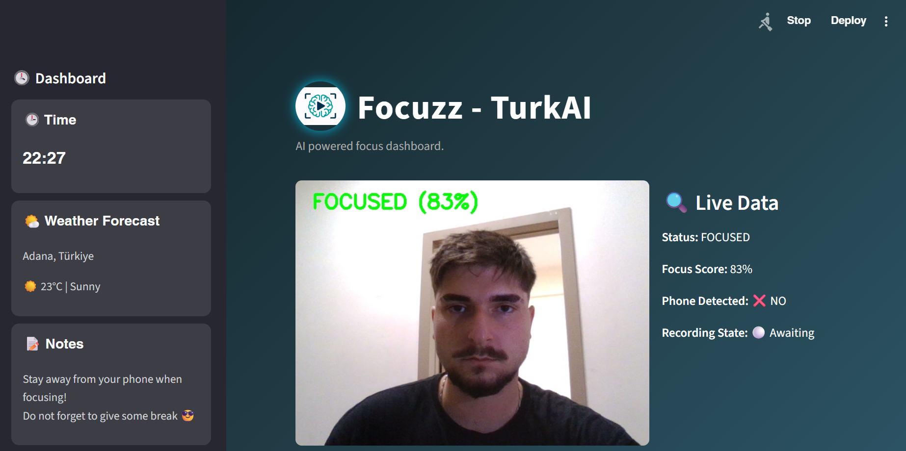
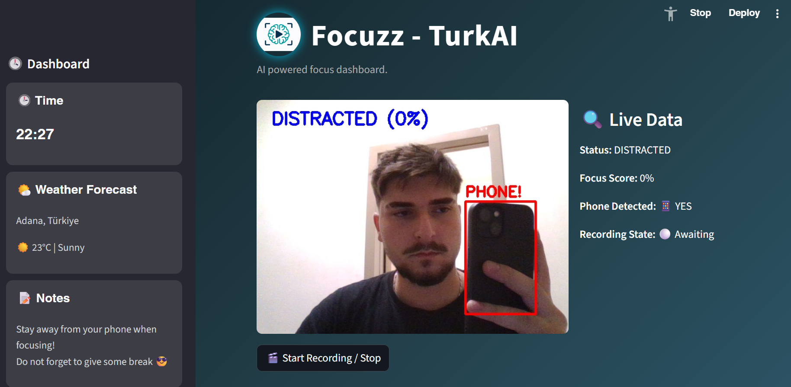

# Focuzz

Focuzz watches you through your webcam while you study or work and tells you how focused you are. It looks at where your head and eyes are pointing, whether your eyes are open, and whether there's a phone in your hand. You can record a session and get a short report at the end.

Built by team TurkAI.

<p>
  
  
</p>

## What it does

- Shows your live camera feed with a focus score from 0 to 100
- Labels each moment as **FOCUSED**, **PARTIAL** or **DISTRACTED**
- Detects phones with YOLOv8 and draws a box around them. A visible phone drops the score to 0
- Records sessions. When you stop, you get the duration, the share of time in each state, how long a phone was on screen and a one-line verdict
- Has a sidebar with the time and a notes box for your to-do list

## How the score works

Each frame goes through MediaPipe Face Mesh. From the landmarks we compute:

| Signal | What it measures |
|---|---|
| Yaw | How far the distance between your eyes drifts from your own baseline, which adapts slowly over time |
| Pitch | Vertical offset between your nose and your eyes |
| Gaze | How far your eyes sit from the horizontal center of the frame |
| Eye openness | Gap between upper and lower eyelids, used as a multiplier |

The score is `100 - 1.2*yaw - 0.9*pitch - gaze`, multiplied by eye openness. Anything above 55 counts as focused and 35 to 55 counts as partial. Below that you're distracted.

At the same time YOLOv8n runs on the frame. If it finds a `cell phone`, the score goes to zero no matter what your face is doing.

## Running it

Requires Python 3.11 and a webcam.

```bash
git clone https://github.com/alp-cihan/focuzz.git
cd focuzz
python -m venv .venv
.venv\Scripts\activate          # macOS/Linux: source .venv/bin/activate
pip install -r requirements.txt ultralytics
streamlit run src/app.py
```

The app opens at `http://localhost:8501`. The YOLOv8n weights (`yolov8n.pt`) download automatically the first time you run it.

If the page says it can't start the camera, check that no other app (Zoom, Teams etc.) is using it. On Windows you may also need to allow desktop apps to use the camera in Privacy settings.

## Data pipeline

Besides the live app, the repo has the scripts we used to turn recorded videos into a labeled dataset:

1. `src/extract_features.py` reads every `.MOV` in `data/raw_videos/models/src/`, samples a frame about every two seconds and writes yaw, pitch, eye openness and face visibility to `data/features_raw.csv`.
2. `src/auto_label.py` groups those samples into windows and labels each window as `focused`, `partially_focused` or `distracted` using threshold rules. The output is `data/labels.csv`.
3. `src/join_labels.py` merges the two into `data/features.csv`.

Run them from the project root in that order. The raw videos aren't in the repo because they're several gigabytes and show the people who recorded them. The resulting CSVs are included.

## Project structure

```
focuzz/
├── src/
│   ├── app.py               # Streamlit dashboard
│   ├── extract_features.py  # video -> per-frame features
│   ├── auto_label.py        # rule-based labeling
│   ├── join_labels.py       # merge features and labels
│   └── logo.jpg
├── data/
│   ├── features_raw.csv
│   ├── labels.csv
│   └── features.csv
├── docs/                    # screenshots
└── requirements.txt
```

## Known limitations

- The score is rule-based. The labeled dataset is there, but no model has been trained on it yet.
- Phone time in the session report assumes roughly 20 frames per second, so it's an estimate.
- Frames where no face is found aren't counted in the session percentages.
- The weather card in the sidebar is a placeholder and doesn't fetch real data.
- The camera is read on the machine running the app, so it only works locally.

## Built with

Streamlit, OpenCV, MediaPipe, Ultralytics YOLOv8, NumPy and pandas.
